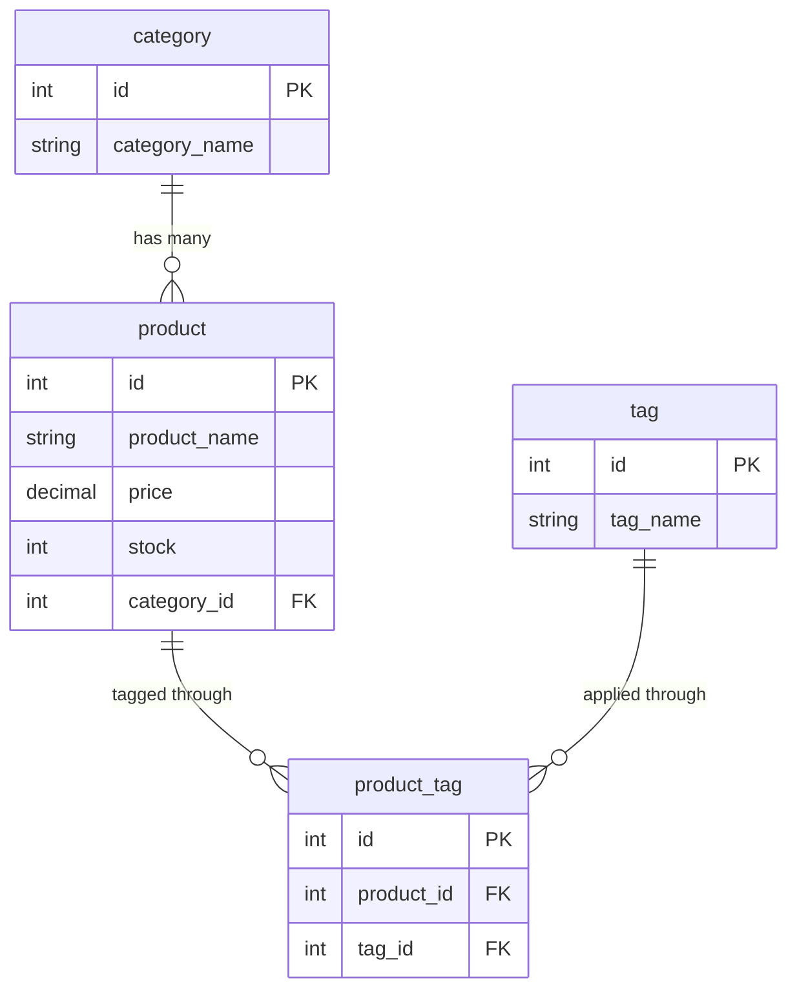

# E-commerce Back End

The back end for an e-commerce site: an Express.js API that uses Sequelize to store categories, products and tags in a MySQL database. It supports full CRUD (create, read, update, delete) for all three, and links products to tags through a join table.

This is the Object-Relational Mapping (ORM) Challenge from a coding boot camp. The app is not deployed, so a walkthrough video is used to demonstrate its functionality.

## Walkthrough Video

[Watch the walkthrough video](https://drive.google.com/file/d/1Zp6MGMca8QJrrSD1uWrHkEtS0dAgmG-g/view?usp=sharing)

## Table of Contents

- [Features](#features)
- [Built With](#built-with)
- [Installation](#installation)
- [Running the API](#running-the-api)
- [Usage](#usage)
- [API Reference](#api-reference)
- [Database Design](#database-design)
- [Project Structure](#project-structure)
- [Troubleshooting](#troubleshooting)
- [Credits](#credits)
- [License](#license)

## Features

- **Categories, products and tags** each have routes to get all, get one, create, update and delete.
- **Related data included in responses:** a category includes its products, a product includes its category and tags, and a tag includes its products.
- **Many-to-many tagging:** a product can have many tags and a tag can belong to many products, using a `product_tag` join table. Creating or updating a product also updates its tag links.
- **Validation:** product names and prices are required, prices are stored as decimals with 2 decimal places, and stock defaults to 10.
- **Seed data** (5 categories, 5 products, 8 tags) to try the API right away.

## Built With

- [Node.js](https://nodejs.org/) and [Express](https://expressjs.com/) for the server and routing
- [MySQL](https://www.mysql.com/) for the database
- [Sequelize](https://sequelize.org/) (v5) as the ORM, with [mysql2](https://github.com/sidorares/node-mysql2)
- [dotenv](https://github.com/motdotla/dotenv) for database credentials
- [nodemon](https://nodemon.io/) for automatic restarts during development
- [Insomnia](https://insomnia.rest/) for testing the routes

## Installation

You need:

- [Node.js](https://nodejs.org/) (the LTS version is fine), which includes npm
- [MySQL](https://dev.mysql.com/downloads/mysql/) installed and running, with a user you can log in as (such as `root`)
- An API client such as [Insomnia](https://insomnia.rest/download) to send requests

**1. Get the code and install the packages:**

```bash
git clone https://github.com/jveyhl/ecommerce_backend.git
cd ecommerce_backend
npm install
```

**2. Add your database credentials.** Create a file named `.env` in the project's top folder (next to `package.json`) with:

```
DB_NAME='ecommerce_db'
DB_USER='root'
DB_PW='your_mysql_password'
```

Use your own MySQL username and password. The `.env` file is not committed to Git, so every copy of the project needs its own.

**3. Create the database.** From the project's top folder, open MySQL and run the schema file:

```bash
mysql -u root -p
```

```sql
source db/schema.sql;
quit;
```

The schema file drops and recreates an empty database named `ecommerce_db`. Run `mysql` from the project's top folder so the `source` path works.

**4. Create the tables and add the sample data:**

```bash
npm run seed
```

This builds all the tables and fills them with sample categories, products, tags and product-tag links. Running it again resets the database to the sample data, so it also erases anything you added.

## Running the API

```bash
npm start
```

For development, `npm run watch` uses nodemon to restart the server whenever you save a file.

When you see `App listening on port 3001!`, the API is ready at **http://localhost:3001/api**. Set a `PORT` environment variable to use a different port.

## Usage

Use Insomnia (or any API client) to send requests to `http://localhost:3001/api`. Send data as JSON, with the `Content-Type` set to JSON. Here are some requests to try with the sample data:

1. `GET /api/categories` returns the five categories, each with its products.
2. `GET /api/products` returns every product with its category and tags.
3. `GET /api/tags/3` returns the "blue" tag with the products that have it.
4. **Create a product** with `POST /api/products`. Include `tagIds`, using `[]` for no tags:

   ```json
   {
     "product_name": "Denim Jacket",
     "price": 59.99,
     "stock": 8,
     "category_id": 1,
     "tagIds": [3, 6]
   }
   ```

   The response lists the product-tag links that were created. Use `GET /api/products` to see the new product.

5. **Change a product's tags** with `PUT /api/products/6`. Include `tagIds`, which becomes the product's full set of tags:

   ```json
   {
     "price": 54.99,
     "tagIds": [3]
   }
   ```

6. **Create a category** with `POST /api/categories` and `{ "category_name": "Jackets" }`, or a tag with `POST /api/tags` and `{ "tag_name": "denim" }`.

## API Reference

### Categories

| Method | Route | Description | Request body |
|---|---|---|---|
| GET | `/api/categories` | Get all categories, with their products | |
| GET | `/api/categories/:id` | Get one category, with its products | |
| POST | `/api/categories` | Create a category | `category_name` |
| PUT | `/api/categories/:id` | Update a category | `category_name` |
| DELETE | `/api/categories/:id` | Delete a category | |

### Products

| Method | Route | Description | Request body |
|---|---|---|---|
| GET | `/api/products` | Get all products, with category and tags | |
| GET | `/api/products/:id` | Get one product, with category and tags | |
| POST | `/api/products` | Create a product and its tag links | `product_name`, `price`, `tagIds` (array), and optionally `stock`, `category_id` |
| PUT | `/api/products/:id` | Update a product and replace its tag links | Fields to change, plus `tagIds` (array) |
| DELETE | `/api/products/:id` | Delete a product | |

### Tags

| Method | Route | Description | Request body |
|---|---|---|---|
| GET | `/api/tags` | Get all tags, with their products | |
| GET | `/api/tags/:id` | Get one tag, with its products | |
| POST | `/api/tags` | Create a tag | `tag_name` |
| PUT | `/api/tags/:id` | Update a tag | `tag_name` |
| DELETE | `/api/tags/:id` | Delete a tag | |

Requests for an `id` that does not exist return a `404` with a message. Invalid data returns a `400`, and unexpected errors return a `500`. Any other route returns `Wrong Route!`.

## Database Design



- A **category** has many **products**, and each product belongs to one category.
- **Products** and **tags** have a many-to-many relationship through the **product_tag** table.

## Project Structure

```
ecommerce_backend/
├── config/
│   └── connection.js         Connects Sequelize to MySQL using .env
├── db/
│   └── schema.sql            Creates the ecommerce_db database
├── models/
│   ├── Category.js
│   ├── Product.js
│   ├── Tag.js
│   ├── ProductTag.js         Join table for products and tags
│   └── index.js              Defines the relationships between models
├── routes/
│   ├── api/
│   │   ├── category-routes.js
│   │   ├── product-routes.js
│   │   ├── tag-routes.js
│   │   └── index.js
│   └── index.js
├── seeds/                    Sample data and the script that loads it
└── server.js                 Starts Express after syncing the database
```

## Troubleshooting

- **`Access denied for user`:** the username or password in `.env` is wrong, or the `.env` file is not in the project's top folder.
- **`Unknown database 'ecommerce_db'`:** the database has not been created. Run `source db/schema.sql;` in MySQL (step 3 of the installation).
- **`Cannot connect` or `ECONNREFUSED`:** MySQL is not running. Start it and try again.
- **`EADDRINUSE`:** port 3001 is already in use. Stop the other program or set a different `PORT`.

## Credits

Built as a coding boot camp challenge. The Express.js API was provided as starter code by the boot camp. I added the Sequelize models, their relationships and the CRUD routes.

## License

Released under the MIT License. See the [LICENSE](LICENSE) file for details.
